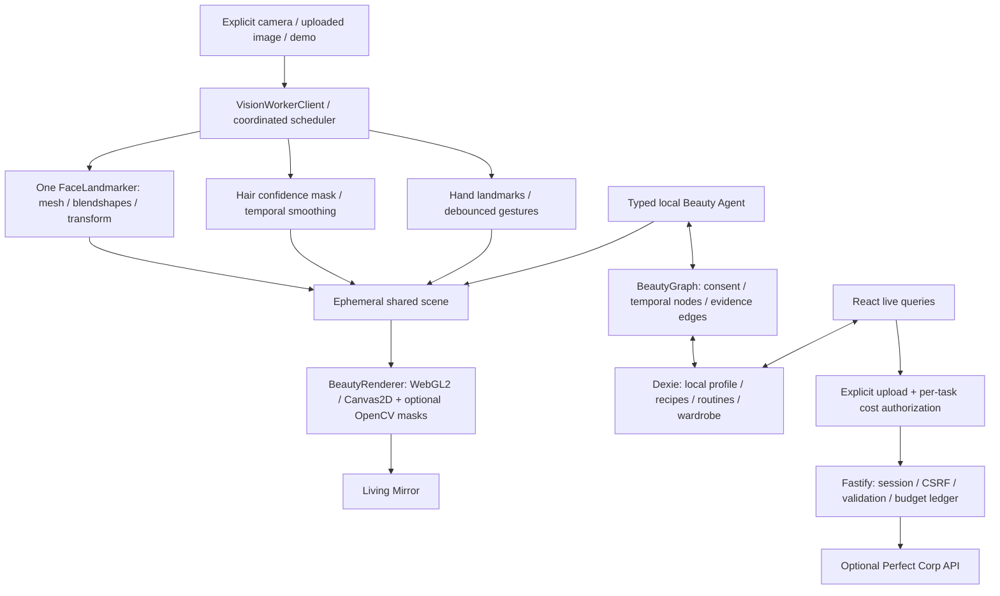

# Architecture

True Beauty is a React19/TypeScript/Vite browser application with a separate optional Fastify5 API. There is no authentication service or remote profile database. Dexie4/IndexedDB is the reactive system of record; Zustand holds the ephemeral current scene. All engines use structural typed contracts; engines do not import UI state.

## Boundaries and main modules

- `apps/web/src`: original design system, spaces, contextual controls, accessibility, interaction state. Shared scene persists across spaces for the current session. Raw source frames remain in memory and are released on unmount.
- `packages/vision-core`: local official models/WASM, one coordinated inference instance, worker/client transfer lifetime, independent cadence/adaptation, actual camera lifecycle. `face-tracking`, `hair-segmentation`, `hand-tracking` own pure geometry/temporal contracts. Rendering consumes normalized unmirrored source coordinates.
- `packages/ar-renderer`, `shader-library`, `makeup-engine`: source-space geometry, effect masks/atlases, source-preserving compositing, material parameters, presets, optional warp, source original/after split. OpenCV is explicitly selected and lazy loaded. Hardware WebGL2 uses shaders; software GPU uses faster Canvas and labels reflective-material limitations. No claimed WebGPU implementation.
- `skin-engine`: sRGB/XYZ/CIELAB and twelve-tone styling heuristics, image suitability checks, actual ROI pixel clustering, dynamic genuine-provider parser. Appearance sampling is not diagnosis, hydration measurement, clinical phototype or a validated classifier.
- `beauty-intelligence`: known ingredient cosmetic roles/sources, actual feature/cosine matching, unique-product AM/PM routine budgets, owned-first selection and explicit missing data.
- `hair-engine`, `fashion-engine`: luminance-preserving palette rules, real garment recolouring, ΔE styling ranks, manually placed static-photo composition, outfit/board models. Generative VTO/hairstyle provider contracts exist; successful generation is not claimed.
- `commerce-engine`: sample catalogue, variant-aware bag utilities, NGN/USD illustrative price snapshots, provenance, search/comparison, no invented stock or checkout.
- `agent-runtime`: Zod-validated typed actions, deterministic scoped planning, actual scene/database callbacks, attributable results, evidence and combined budget plans. LLM adapter contract exists; no remote LLM is configured.
- `local-database`, `beauty-memory`: versioned schema, transactional consent, deduplication/supersession/retention, attributed graph/history deletion, validated atomic import, encrypted optional backup with user-derived key.
- `apps/api`: current documented Perfect Corp registration/upload/task/poll, configured capability health, consent/cost controls. Credentials are server environment only, never VITE variables/IndexedDB/browser config.

## Local privacy and persistence

Default initialization stores a local profile identifier, no remote identity. Saved looks store parameters only. Chat/history/preference memory and skin observation history each have explicit separate consent. No implicit raw-photo, geometry, face identity or embedding storage. Clothing photos require a separate photo-storage choice. Revocation and writes include the consent table in the same Dexie transaction, closing tested race conditions. Deletion cascades dependent graph edges, revisions and attributed episode prose. Import never grants consent and filters graph/history dependencies under the same transaction.

Optional backup excludes photos. AES-GCM uses a fresh96-bit IV and PBKDF2-SHA256(user passphrase, fresh128-bit salt,310000 iterations); keys are nonextractable and not stored. Local IndexedDB itself is not encrypted or cross-device synchronized.

## Offline and loading

The production build generates a deterministic service-worker precache from actual hashed UI assets. No API response or personal media is cached. Models and WASM are lazy and runtime-cached after use; optional OpenCV is omitted from precache. Saved recipes, routines, inventory, notes and permitted memory need no network. The development HMR server is not an offline distribution; production offline tests exercise the built app.

## Reliability and performance

Inference uses transferred ImageBitmap frames in a dedicated worker when supported, bounded input sizes and measured-cost adaptive cadence. A main-thread pipeline is retained for unsupported workers. Image rendering is dirty-driven; static portraits are not reprocessed each animation frame. Camera rendering is separate from inference; temporal masks/landmarks are shared. Rendering uses a resolution cap, caches source-aligned masks and has an explicit software/GPU-loss fallback. Browser resize/zoom maps split position back through crop coordinates. No60FPS/device claim is inferred from rAF cadence.

`docs/VISION_REPORT.md` and `cook/stills/graphics/report.json` contain actual managed-cloud measurements and their limits. Physical-device quality, sustained allocations, fairness and production deployment remain separate gates.

## Provider service limitations

The API is a single-process pilot. Durable conservative spending reservation prevents overspend within that process/restarts, but multi-instance deployment requires a transactional shared budget store. In-memory temporary tasks expire15minutes. Provider-side retention cannot be controlled beyond the documented agreement and is disclosed before upload. No live credentials/pricing authorization are configured. Remote features fail closed, with no synthetic results.
