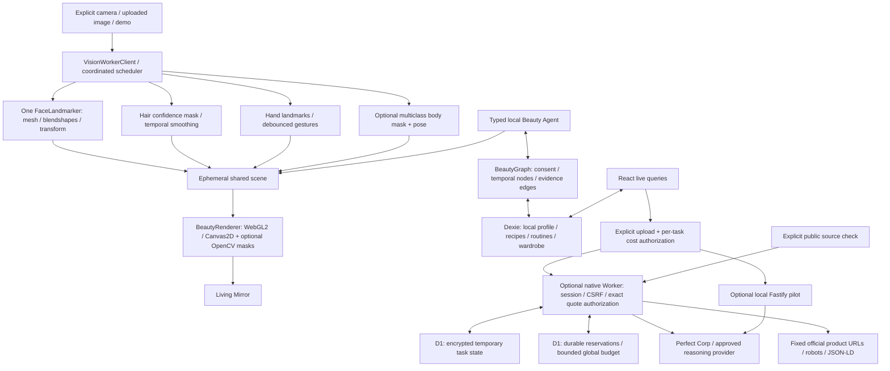

# Architecture

True Beauty is a React19/TypeScript/Vite browser application. Dexie4/IndexedDB is the reactive system of record for personal profiles, BeautyGraph, wardrobe, routines and saved work; Zustand holds the ephemeral scene. Optional remote operations have two compatible transports: the local Fastify5 pilot and the R07 native Fetch Worker. The Worker uses encrypted D1 temporary tasks plus durable conservative accounting, with no remote beauty-profile database or end-user account requirement. Engines use structural typed contracts and do not import UI state. R07 native version5 is publicly deployed; genuine scoped provider operations are recorded in LIVE_PROVIDER_VERIFICATION_R07. Personal memory remains local.

## Boundaries and main modules

- `apps/web/src`: original design system, spaces, contextual controls, accessibility, interaction state. Shared scene persists across spaces for the current session. Raw source frames remain in memory and are released on unmount.
- `packages/vision-core`: local official models/WASM, one coordinated inference instance, worker/client transfer lifetime, independent cadence/adaptation, actual camera lifecycle. `face-tracking`, `hair-segmentation`, `hand-tracking` own pure geometry/temporal contracts. Rendering consumes normalized unmirrored source coordinates.
- `packages/ar-renderer`, `shader-library`, `makeup-engine`: source-space geometry, effect masks/atlases, source-preserving compositing, material parameters, presets, optional warp, source original/after split. OpenCV is explicitly selected and lazy loaded. Hardware WebGL2 uses shaders; software GPU uses Canvas with explicitly approximate reflective materials, and users can select bounded WebGL detail. No claimed WebGPU implementation.
- `skin-engine`: sRGB/XYZ/CIELAB and twelve-tone styling heuristics, image suitability checks, actual ROI pixel clustering, dynamic genuine-provider parser. Appearance sampling is not diagnosis, hydration measurement, clinical phototype or a validated classifier.
- `beauty-intelligence`: known ingredient cosmetic roles/sources, actual feature/cosine matching, unique-product AM/PM routine budgets, owned-first selection and explicit missing data.
- `hair-engine`, `fashion-engine`: luminance-preserving palette rules, real garment recolouring, ΔE styling ranks, manually placed static-photo composition, outfit/board models. Real YouCam hair-transfer and cloth-v4 adapters have genuine synthetic-fixture success receipts. Manual static composition remains explicitly separate.
- `commerce-engine`: sample catalogue, variant-aware bag utilities, NGN/USD illustrative price snapshots, provenance, search/comparison, no invented stock or checkout.
- `agent-runtime`: Zod-validated typed actions, deterministic scoped planning, actual scene/database callbacks, attributable results, evidence and combined budget plans. LLM adapter contract exists; native Claude Messages has an actual bounded three-turn/two-action receipt, while the local planner remains the default.
- `local-database`, `beauty-memory`: versioned schema, transactional consent, deduplication/supersession/retention, attributed graph/history deletion, validated atomic import, encrypted optional backup with user-derived key.
- `apps/api`: current documented Perfect Corp registration/upload/task/poll, capability health, consent/cost controls and the local Fastify transport. Pure `youcamSkinProvider.ts`, `generationProvider.ts`, `youcamTransport.ts`, `youcamImage.ts`, `reasoningProvider.ts` and `merchantProvider.ts` are shared with the native Worker; Node wrappers preserve existing exports. Credentials are server-only, never VITE variables/IndexedDB/browser config.
- `apps/edge/src`: native Worker bootstrap/authentication boundary, Fetch provider/reasoning/merchant handlers, encrypted `HostedStore`, CAS leases and atomic quote/reservation/accounting. It preserves existing `/api` browser contracts. Public source lookups need no paid grant; paid providers require the approved owner-bound quote and explicit user consent. `apps/edge/build` provides the Sites/Cloudflare build adapter; the cleared MIT Common Table Sites plugin is attributed in SOURCE_INTEGRATION_MATRIX.

## Local privacy and persistence

Default initialization stores a local profile identifier, no remote identity. Saved looks store parameters only. Chat/history/preference memory and skin observation history each have explicit separate consent. No implicit raw-photo, geometry, face identity or embedding storage. Clothing photos require a separate photo-storage choice. Revocation and writes include the consent table in the same Dexie transaction, closing tested race conditions. Deletion cascades dependent graph edges, revisions and attributed episode prose. Import never grants consent and filters graph/history dependencies under the same transaction.

Optional backup excludes photos. AES-GCM uses a fresh 96-bit IV and PBKDF2-SHA256(user passphrase, fresh128-bit salt,310000 iterations); keys are nonextractable and not stored. Local IndexedDB itself is not encrypted or cross-device synchronized.

## Offline and loading

The production build generates a deterministic service-worker precache from actual hashed UI assets. No API response or personal media is cached. Models and WASM are lazy and runtime-cached after use; optional OpenCV is omitted from precache. Saved recipes, routines, inventory, notes and permitted memory need no network. The development HMR server is not an offline distribution; production offline tests exercise the built app.

## Reliability and performance

Inference uses transferred ImageBitmap frames in a dedicated worker when supported, bounded input sizes and measured-cost adaptive cadence. A main-thread pipeline is retained for unsupported workers. Image rendering is dirty-driven; static portraits are not reprocessed each animation frame. Camera rendering is separate from inference; temporal masks/landmarks are shared. Rendering uses a resolution cap, caches source-aligned masks and has an explicit software/GPU-loss fallback. Browser resize/zoom maps split position back through crop coordinates. No60FPS/device claim is inferred from rAF cadence.

`docs/VISION_REPORT.md` and `cook/stills/graphics/report.json` contain actual managed-cloud measurements and their limits. Physical-device quality, sustained allocations, fairness and production deployment remain separate gates.

## Provider transports and hosted state

The Node API remains a single-process pilot with process-local tasks and a conservative file ledger. Its Fastify/find-my-way runtime failed the R06 workerd investigation; those old wrappers are not used as the native hosted entry. R07 extracts their real Fetch-compatible providers and mounts native handlers in `apps/edge/src/worker.ts`. The frozen `paid-boundary.ts`/EDGE_R06 voucher proof remains historical, separate from the production runtime and generated Drizzle schema.

The Worker verifies its exact HTTPS origin, HMAC-signed one-hour anonymous ownership/CSRF cookie and independent IP/session limits. Core local work and public catalogue/source browsing require no beauty account. Sponsored provider use additionally needs a server-verified operator or an operator-approved exact quote. A platform identity header is trusted only under the explicitly configured platform dispatch contract; public-origin forgery/resume verification remains an integration gate. Server credentials and security keys remain outside browser data, task values and build assets.

`HostedStore` encrypts permitted task/settings/results/approved text context with AES-GCM using a separate server-only secret, fresh IVs and authenticated identity/owner/version/expiry metadata. Record access ends at original creation plus at most 15 minutes, without extension by polling. Cleanup runs during later activity; exact wall-clock physical deletion and platform backup erasure are not promised. Raw image/base64 bytes remain request-local and go only to the explicitly authorized provider; D1/R2 do not store those images. Generated pixels and concern masks use bounded owner-checked proxies with an allowlisted upstream media host.

Quote consumption, encrypted task creation and both credit/micro-USD reservations share one D1 transaction with an authorization/budget trigger. A one-time operator reconciliation carries forward prior conservative reservations under stable global ceilings; migrations contain no zero seed or automatic date rollover. Minimal accounting receipts and totals outlive temporary task content so deleting an image task or restarting an isolate cannot reset spending. CAS uses globally monotonic opaque SQLite epochs, including across expiry/deletion, to prevent a suspended old lease overwriting a replacement.

YouCam tasks persist real upstream IDs and status for another isolate to resume. Ambiguous dispatch becomes `uncertain` and keeps its reservation instead of automatically repeating a paid action. Reasoning stores only the exact consented text/tool scope, requires actual local tool feedback, clears full transcript content on completion/cancellation and retains bounded encrypted responses until task expiry for retry safety. Public merchant lookups use fixed robots-checked URLs, shared up-to-15-minute factual caches and one-minute failures, never a paid provider grant.

Source configuration and a successful local Worker/SPA build are established; hosted deployment, owner/operator trust and genuine hosted requests are not established by that build. Local evidence includes actual two-isolate workerd/D1 store and merchant probes, a six-assertion workerd reasoning-protocol probe, and native YouCam loopback/real-SQLite route tests. R06 genuine skin/hair/clothing/Claude receipts remain local pilot evidence. Provider-side 30-day media retention, actual billing, broad security/rights clearance and physical-device/population performance remain separate. See HOSTED_STORE_R07, EDGE_YOUCAM_R07, MERCHANT_R07 and API_CONTRACTS.

## Round05 scene/editor contracts

`RenderFrame.lighting` is validated through `LightingSettings`; neutral is source identity, while creative grading only affects the preview. The original half of comparisons stays original. Canvas and GLSL share numerical pigment behavior; materials differ in fidelity. Runtime quality/resolution controls release prior resources rather than stacking renderers. See IMMERSIVE_RENDERING for actual measurements.

Zustand keeps ephemeral portrait URL/shared cloned vision snapshot, view framing/zoom/split/focus and bounded parameter-only undo/redo. Source identity rejects obsolete snapshots. LookGallery consumes that one shared analysis; it does not run six redundant trackers. Lighting and undo are not written as personal images or biometric records. Dexie remains the persistence authority for deliberate saved recipes/boards.

Spatial canvas state has a validated persistent view plus contextual object selection. Palette actions mutate actual makeup tools; product handoffs include a verified catalogue ID and shade. `StudioMode` includes light so agent/region/palette handoffs cannot leave competing local inspector states. Source views and local exports remain image-consent aware.

## Round06 connected scene and evidence contracts

VisionSnapshot has optional semantic body masks and 33-point pose output. The coordinated scheduler can share multiclass hair output rather than run two hair models; optional failures do not disable face tracking. Semantic occlusion is explicitly image-plane overlap, not a calibrated body-depth reconstruction. Body inference is opt-in and adaptive because its real CPU fixture was expensive.

Look Remix uses measured source regions and user correction to build a structured look. It never transfers source foundation tone onto the target skin. Digital Twin is an editable self-described cosmetic profile, not a biometric or medical reconstruction. Complete-look composition stores current pigments/hair/accessories, creative light, actual owned product IDs, saved outfit ID and profile revision. Reopen restores those controls atomically; images remain session-only unless independently consented storage is selected.

Dexie version3 canonicalizes bag identity as product/size/variant/currency/source. Portable imports are validated atomically, preserve separate currencies and mark old source quotes imported. Digital Twin exports normalize look payloads, project typed fields and redact binary/Blob references even after adversarial passthrough imports. Read/delete races reject recoverably rather than return an undefined profile.

Provider contracts are in API_CONTRACTS, REMOTE_PROVIDERS_R06 and REASONING_ROUND06, with the R07 continuation described above. Native Claude uses exact approved text snapshots and actual local tool feedback. Images/history are not implicitly added. The R06 edge voucher/D1 prototype cannot dispatch providers; R07's separate native implementation supplies actual public runtime/storage integration and scoped genuine hosted operations. Full hosted skin-history persistence and owner browser recognition remain unverified; see LIVE_PROVIDER_VERIFICATION_R07.
